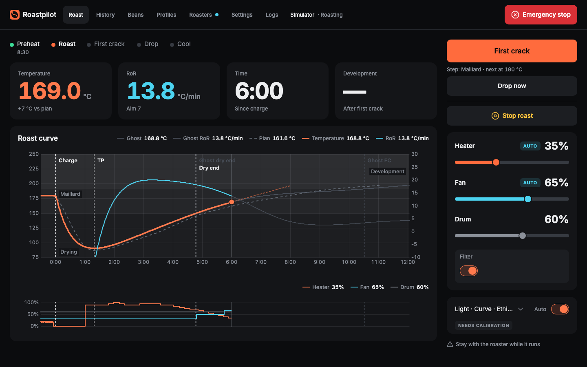
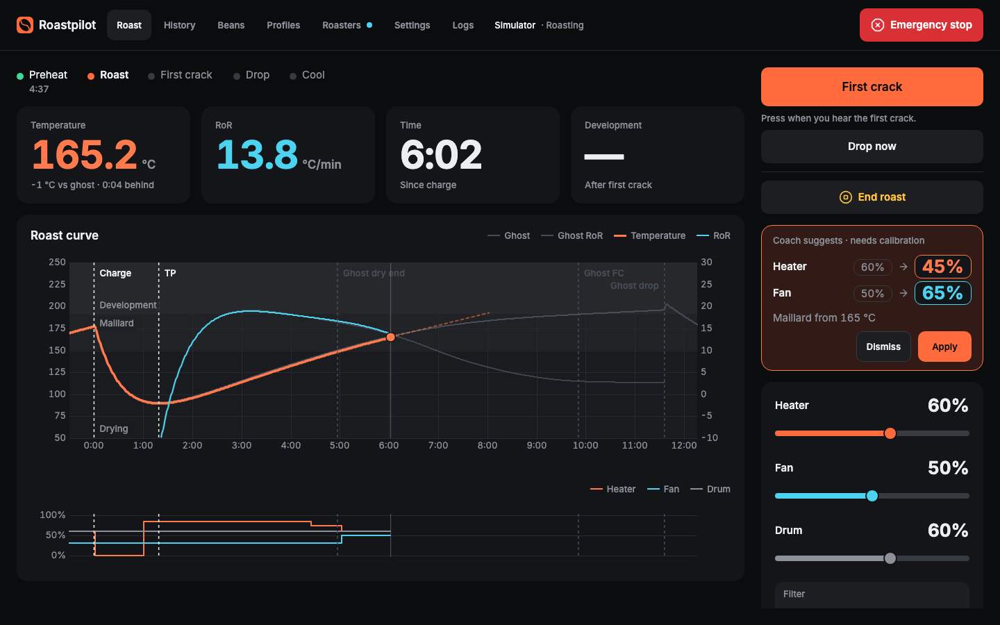
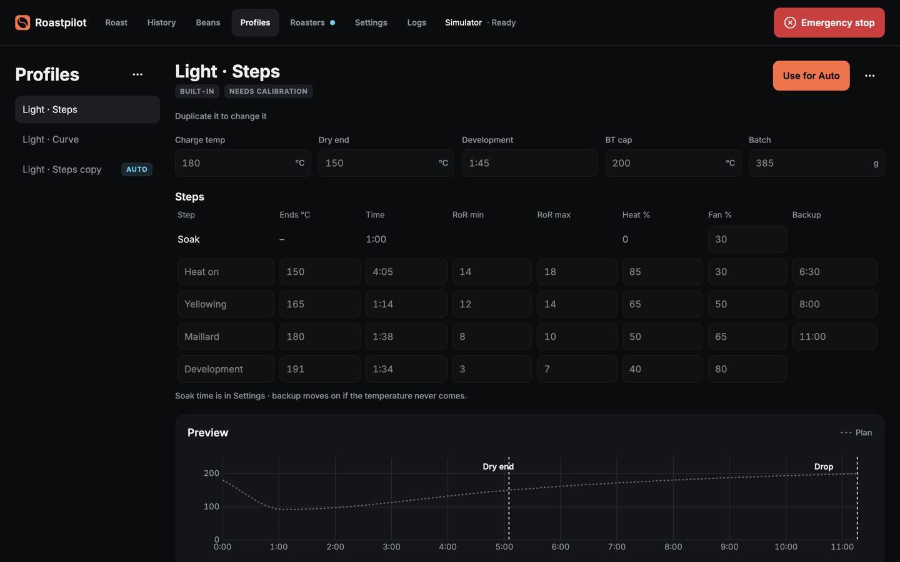
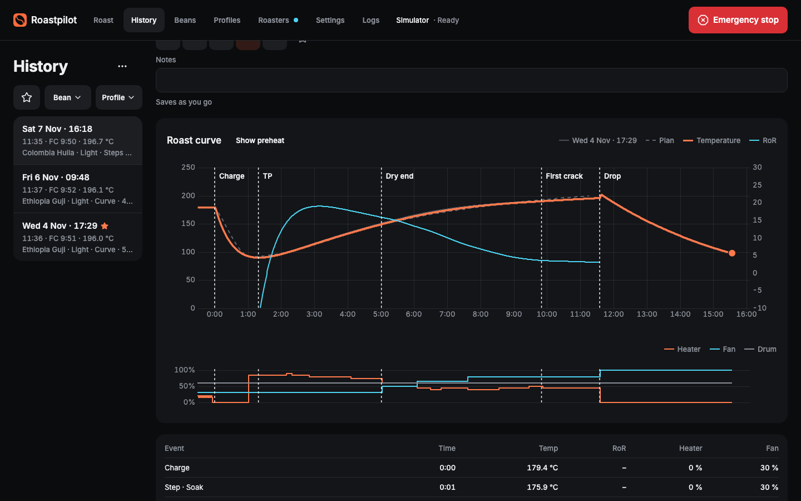
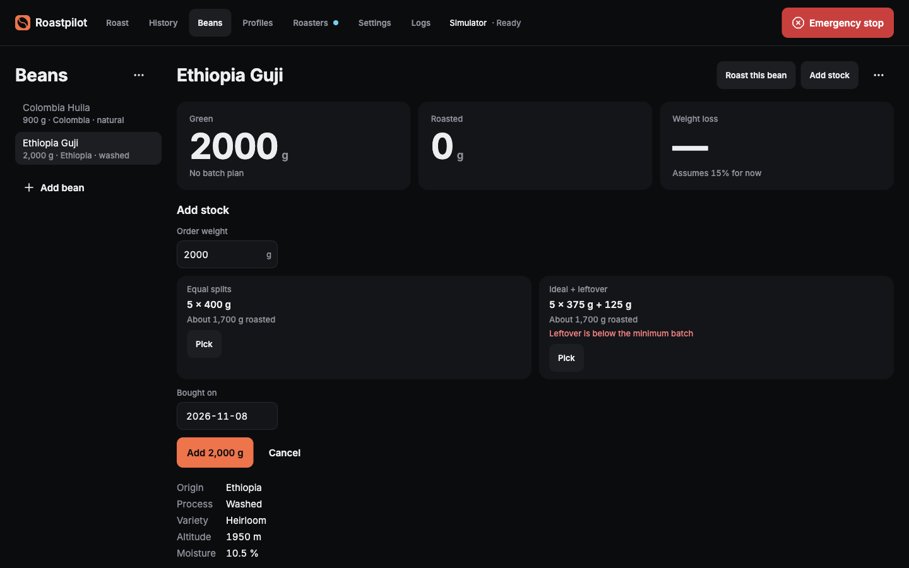
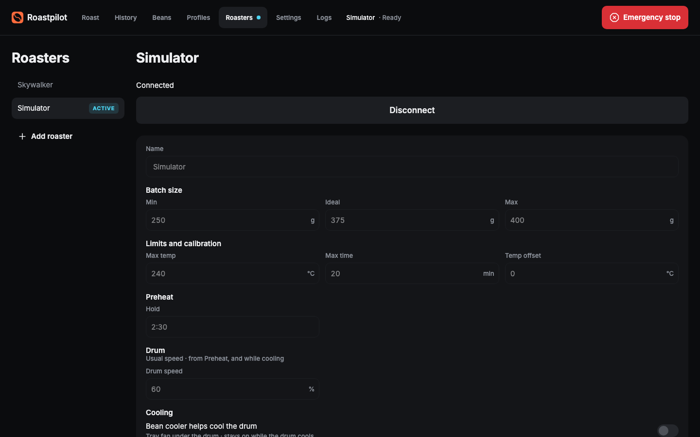

# Roastpilot

Roasts coffee on autopilot. Lets you take the controls whenever you want.

Roastpilot is a desktop app for macOS and Windows that runs a small drum roaster from your computer.
Pick a bean and a profile, press Start, and it preheats, drives heater and fan along the profile,
marks dry end, waits for your first-crack tap, then drops and cools on its own. In Manual you set
heater and fan yourself, with the same chart, numbers and safety rules. It starts with a modded
Skywalker roaster and has a built-in Simulator, so you can try it without hardware.

> Status: in active development, no release yet. See [CHANGELOG.md](CHANGELOG.md).

## Safety

Roastpilot switches a heater. Use it at your own risk.

- **Never leave a roaster unattended**, in Manual or in Auto.
- **Auto is not a safety device.** The app's safety rules (max temperature, lost connection, max
  roast time, stalled temperature) help, but software and computers fail.
- **Keep the hardware safety in place:** the roaster's thermal fuses and cut-outs, and the sketch's
  watchdog that turns the heater off when the app goes quiet. Don't bypass them.
- Roastpilot is free software with **no warranty**, as sections 15 and 16 of the
  [GPL-3.0](LICENSE) say.

How the app's safety rules work: [docs/spec/safety.md](docs/spec/safety.md).

## Features

- **Auto:** step profiles (end temperature, duration and RoR range per step, with a planned fan) or
  curve profiles (follow a temperature curve). Between-batch preheat, dry end by temperature, drop
  and cooling on their own. Built-in Light profile for the Skywalker; duplicate and edit your own.
- **Manual:** heater, fan, drum and filter by hand; switch between Auto and Manual mid-roast. A live
  coach that suggests the next setting is planned ([manual-mode.md](docs/spec/manual-mode.md)).
- **Live chart:** temperature, RoR, the profile's curve, markers (charge, turning point, dry end,
  first crack, drop) and an outputs strip under it.
- **Ghost roasts:** a past roast drawn behind the live one, picked for you, changeable.
- **Beans and stock:** a bean library, green stock that goes down with each roast, weight loss, and
  a batch calculator.
- **History:** every roast saved, compare two, star favourites, make a profile from a roast. Export
  as Roastpilot files or CSV; import Roastpilot files and Artisan `.alog` roasts.
- **Sounds:** short cues when something needs you (charge soon, listen for first crack, dump
  beans, Auto stopped), so you hear them over the roaster.
- **Logs screen:** the app's own log, live, for when something goes wrong.

## Screenshots

Auto mid-roast on the Simulator: following the Light · Curve plan, with a 5★ roast as the ghost.



Manual: you drive heater and fan; the numbers say how you compare with the ghost.



|                                                                        |                                                                |
| ---------------------------------------------------------------------- | -------------------------------------------------------------- |
|  |        |
| **Profiles:** steps by temperature, with a preview                     | **History:** compare any two roasts                            |
|         |  |
| **Beans:** stock and the batch calculator                              | **Roasters:** connect a roaster, or the Simulator              |

## Supported roasters

| Roaster   | How it connects                                                                                                                                                         |
| --------- | ----------------------------------------------------------------------------------------------------------------------------------------------------------------------- |
| Skywalker | USB serial to an ESP32 running the SkyCommand sketch (from [SkywalkerRoaster](https://github.com/jmoore52/SkywalkerRoaster)). See [hardware.md](docs/spec/hardware.md). |
| Simulator | Built in; no hardware. Good for trying the app and for tests.                                                                                                           |

Want another roaster? Open a [new roaster request](https://github.com/mnabaci/Roastpilot/issues/new?template=new_roaster.yml);
drivers are plug-ins ([extensibility.md](docs/spec/extensibility.md)).

## Install

Download the latest from [GitHub Releases](https://github.com/mnabaci/Roastpilot/releases): the
`.dmg` for macOS, the `Setup .exe` for Windows. Builds aren't signed yet, so each system asks once:

- **macOS:** drag Roastpilot to Applications and open it; macOS says it can't check it for
  malware: **Done**. Then System Settings → Privacy & Security → **Open Anyway** (near the bottom)
  → **Open Anyway** again. Only the first time.
- **macOS 0.1.0 only** ("is damaged and can't be opened"): that build wasn't signed at all. Press
  Cancel, then in Terminal run `xattr -cr /Applications/Roastpilot.app` and open it. From 0.1.1 on
  the steps above work.
- **Windows:** SmartScreen says "Windows protected your PC": **More info** → **Run anyway**.

Updates (Settings › About shows where you are):

- **Windows and macOS:** downloads in the background and installs when you quit, or press
  **Restart to update**. Never during a roast.
- **macOS:** from 0.1.2 on, once Roastpilot is in Applications. Run from the DMG or Downloads,
  About says "Version X is out · move Roastpilot to Applications to update by itself" and
  **Download** opens the release. 0.1.1 and older only show Download: install 0.1.2 over the old
  app once. Your roasts, beans and settings stay.
- Before a new version changes the database, it saves a copy in the app's `backups` folder.

How releases and updates work: [install-and-update.md](docs/spec/install-and-update.md).

## Quick start from source

Needs Node 24 LTS (22.22+ works) and pnpm 10 (`corepack enable`).

```sh
git clone https://github.com/mnabaci/Roastpilot.git
cd Roastpilot
pnpm install
pnpm dev
```

1. The app opens on **Roasters**. Pick **Simulator** and press **Connect**.
2. Go to **Roast**, switch to **Auto**, pick a profile and press **Preheat**.
3. At "Add beans", press **Start**. Tap **First crack** when it comes; Auto drops and cools.

For a real Skywalker, flash the sketch in [`firmware/skywalker-tc4/`](firmware/skywalker-tc4/README.md),
plug it in, pick its port on the Skywalker roaster's page, and Connect.

## Docs

| Where                              | What                                                                      |
| ---------------------------------- | ------------------------------------------------------------------------- |
| [docs/spec](docs/spec)             | What the app does and how it is built; the source of truth, changed first |
| [docs/adr](docs/adr)               | Decisions that are hard to reverse, and why                               |
| [CONTRIBUTING.md](CONTRIBUTING.md) | Setup, commands, how work flows, rules                                    |
| [CLAUDE.md](CLAUDE.md)             | The project's rules in one page (also loaded by AI assistants)            |

## Repository

| Path                    | What                                                                |
| ----------------------- | ------------------------------------------------------------------- |
| `apps/desktop`          | Electron app (main, preload, renderer)                              |
| `packages/core`         | Roasting logic: state machine, PID, rules, safety (pure TypeScript) |
| `packages/drivers`      | Roaster drivers and transports, incl. the simulator                 |
| `packages/storage`      | SQLite schema, migrations, repositories                             |
| `packages/shared`       | Types and the IPC contract                                          |
| `packages/ui`           | Design-system components and tokens                                 |
| `firmware/`             | The SkyCommand sketch and its protocol                              |
| `docs/spec`, `docs/adr` | Spec and decisions                                                  |
| `.claude/`              | Agent skills, hooks and rules                                       |

## Contributing

Bug reports, roaster drivers and fixes are welcome. Start with [CONTRIBUTING.md](CONTRIBUTING.md)
and the [code of conduct](CODE_OF_CONDUCT.md). Security and safety bugs: see [SECURITY.md](SECURITY.md).

## Licence

Roastpilot is free software under the GNU General Public License v3.0 or later
(SPDX: `GPL-3.0-or-later`). See [LICENSE](LICENSE). The SkyCommand sketch in `firmware/` is
GPL-3.0, adapted from SkywalkerRoaster.
