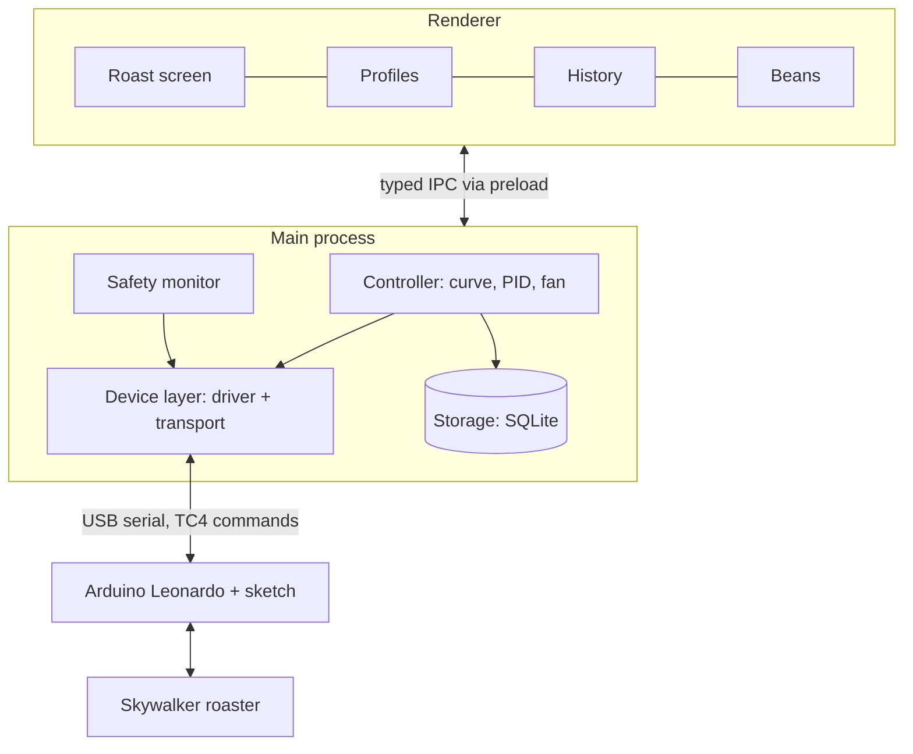

# Architecture

All roaster control runs in Electron's main process; the UI only displays data and sends
requests over IPC. A frozen or closed window can't leave the heater on.

- **Device layer:** two interfaces, so the hardware can change without touching the rest.
  - `RoasterDriver` (`connect`, `read`, `setHeater`, `setFan`, `setCooling`, `safeStop`, `channels`) is all the controller ever sees.
  - `Transport` (`open`, `write`, `onLine`, `close`) only moves bytes: `SerialTransport` now, Wi-Fi or Bluetooth later.
  - `Tc4SkywalkerDriver` is the Adapter for the current Arduino mod; `SimulatedDriver` fakes a roaster for development and tests.
  - `DriverFactory` builds the driver chosen for the active roaster.
- **Controller:** runs the roast state machine (preheat → charge → roast → drop → cool), the PID and the fan schedule.
- **Safety monitor:** watches every reading and can force a safe stop, whatever the controller is doing.
- **Storage:** writes samples and events to SQLite during the roast, so a crash loses at most a second.
- **Renderer:** React built from `@roastpilot/ui`, with uPlot for the live chart. It talks only through the typed `window.roastpilot` API: `startRoast`, `markFirstCrack`, `setOutput`, `onReading`, and so on.
