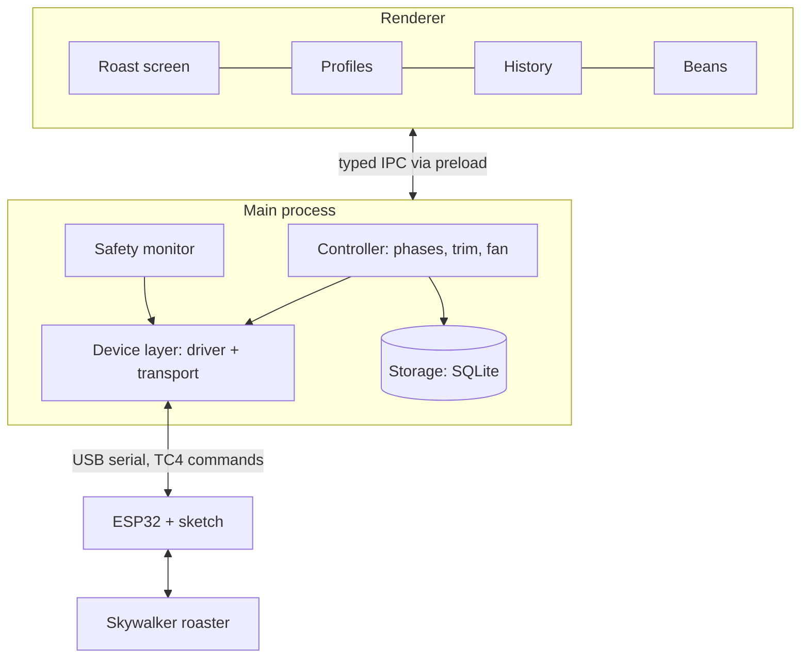

# Architecture

All roaster control runs in Electron's main process; the UI only displays data and sends
requests over IPC. A frozen or closed window can't leave the heater on.

- **Device layer:** two interfaces, so the hardware can change without touching the rest.
  - `RoasterDriver` is all the controller ever sees: `channels`, `connect`, `read`, `setOutput(channel, value)`, `safeStop`, `disconnect` ([ADR 0009](../adr/0009-generic-driver-outputs.md)).
  - `connect`, `read` and `setOutput` return typed results (`disconnected`, `no-reply`, `bad-reply`, `version-mismatch`, `unknown-channel`, `safety-locked`); only `safeStop` never fails, it does its best and resolves.
  - Drivers clamp and round every value to the channel's range and step before sending.
  - Time comes from an injected `Clock` (`now`, `delay`), so drivers and the simulator run on fake time in tests.
  - `Transport` (`open`, `write`, `onLine`, `onClose`, `close`) only moves lines of text: `SerialTransport` now, Wi-Fi or Bluetooth later.
  - `Tc4SkywalkerDriver` is the Adapter for the current ESP32 mod; `SimulatedDriver` fakes a roaster for development and tests.
  - `DriverFactory` builds the driver chosen for the active roaster: `Tc4SkywalkerDriver` over `SerialTransport` for a port, or `SimulatedDriver`.
- **Roaster session:** `RoasterSession` in `core` owns the connected roaster: it wraps the driver in `SafetyGuardedDriver`, polls `READ` every 1 s, runs the safety `check()` on its own 1 s loop, reconnects by itself after a lost connection, and publishes readings, safety events and connection changes. One session lives for the whole app, so the heater lock survives a reconnect.
- **Controller:** runs the roast state machine (preheat → charge → phases → drop → cool), the planned heat and fan steps and the PID trim.
- **Safety monitor:** watches every reading and can force a safe stop, whatever the controller is doing.
- **Storage:** a `RoastRecorder` in `core` turns roast and reading events into writes on a `RoastRepository` (implemented in `storage`), during the roast, so a crash loses at most a second (docs/spec/data-model.md, Saving a roast).
- **Renderer:** React built from `@roastpilot/ui`, with uPlot for the live chart. It talks only through the typed `window.roastpilot` API: `startRoast`, `markFirstCrack`, `setOutput`, `onReading`, and so on.
- **IPC contract:** channel names and zod schemas live in `@roastpilot/shared`. Main validates every payload from the renderer before acting on it.

| Call                          | Kind   | Payload → result                                                                                                           |
| ----------------------------- | ------ | -------------------------------------------------------------------------------------------------------------------------- |
| `listPorts`                   | invoke | – → serial ports                                                                                                           |
| `connect`                     | invoke | `{ kind: 'serial', path }` or `{ kind: 'simulator' }` → result                                                             |
| `disconnect`                  | invoke | – → safe stop, then closed                                                                                                 |
| `setOutput`                   | invoke | `{ channel, value }` → result (`safety-locked` while locked)                                                               |
| `emergencyStop`               | invoke | – → safe stop and heater lock                                                                                              |
| `acknowledgeSafety`           | invoke | – → result (`still-tripped` while a rule holds)                                                                            |
| `onReading`                   | event  | reading every 1 s                                                                                                          |
| `onConnection`                | event  | `disconnected`, `connecting`, `connected` (with channels) or `lost`; all but `disconnected` carry the target               |
| `onSafetyEvent`               | event  | `tripped`, `cleared`, `unlocked`                                                                                           |
| `getSnapshot`                 | invoke | – → connection, roast state, readings so far, safety lock and tripped rules (for a window that opens or reloads mid-roast) |
| `roastAction`                 | invoke | `preheat`, `start`, `first-crack`, `drop` → result (`not-allowed` in the wrong state)                                      |
| `onRoast`                     | event  | roast state, events (charge, first crack, drop) and timings                                                                |
| `getSettings` / `setSettings` | invoke | – / settings → settings (validated)                                                                                        |
| `listLogDays`                 | invoke | – → days with a log file, newest first                                                                                     |
| `readLogDay`                  | invoke | `YYYY-MM-DD` → the day's last 2,000 entries and how many lines were unreadable                                             |
| `onLogEntries`                | event  | new log entries as they are written, batched                                                                               |
| `openLogFolder`               | invoke | – → opens the log folder in Finder or Explorer                                                                             |
| `listRoasts`                  | invoke | – → saved roasts, newest first (summary only)                                                                              |
| `getRoast`                    | invoke | roast id → the roast with its samples and events, or `not-found`                                                           |
| `deleteRoast`                 | invoke | roast id → result                                                                                                          |
| `onRoastsChanged`             | event  | a roast was saved, finished or deleted, and which (History refreshes)                                                      |
| `autoChargeSoon`              | invoke | – → heater 0 and the countdown before the beans go in, or `not-now`                                                        |
| `autoResume`                  | invoke | – → heater and fan back to Auto, or `safety-locked`                                                                        |
| `onAutoStatus`                | event  | what Auto is doing: on or off, who owns each output, preheat step, running step                                            |
| `listProfiles`                | invoke | – → built-ins, then your own                                                                                               |
| `duplicateProfile`            | invoke | profile id → the new copy, or an error                                                                                     |
| `saveProfile`                 | invoke | profile → the saved entry; refuses a built-in                                                                              |
| `deleteProfile`               | invoke | profile id → result; refuses a built-in                                                                                    |
| `onNavigate`                  | event  | the app menu asks for a screen (`settings` from Settings…)                                                                 |

- **Quit and crash:** before the app quits, and on an uncaught error in main, the session sends the safe stop (given up to 2 s) before anything else.
- **Clock:** main uses a monotonic clock (`performance.now()`), so a system clock change can't fool the lost-connection rule.
