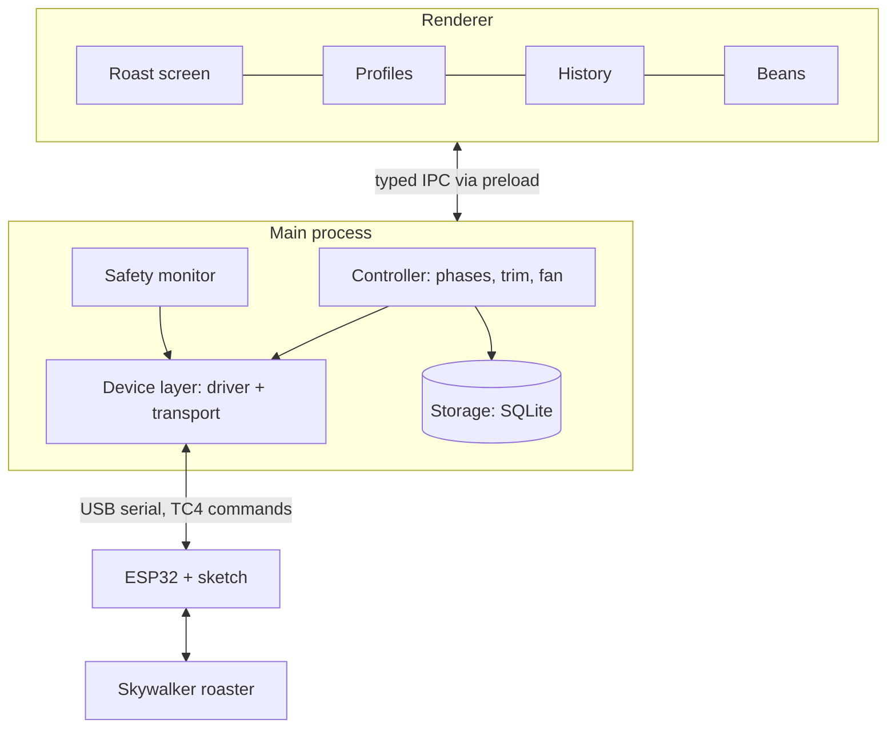

# Architecture

All roaster control runs in Electron's main process; the UI only displays data and sends
requests over IPC. A frozen or closed window can't leave the heater on.

- **Device layer:** two interfaces, so the hardware can change without touching the rest.
  - `RoasterDriver` is all the controller ever sees: `channels`, `connect`, `read`, `setOutput(channel, value)`, `safeStop` ([ADR 0009](../adr/0009-generic-driver-outputs.md)).
  - `connect`, `read` and `setOutput` return typed results (`disconnected`, `no-reply`, `bad-reply`, `version-mismatch`, `unknown-channel`); only `safeStop` never fails, it does its best and resolves.
  - Drivers clamp and round every value to the channel's range and step before sending.
  - Time comes from an injected `Clock` (`now`, `delay`), so drivers and the simulator run on fake time in tests.
  - `Transport` (`open`, `write`, `onLine`, `onClose`, `close`) only moves lines of text: `SerialTransport` now, Wi-Fi or Bluetooth later.
  - `Tc4SkywalkerDriver` is the Adapter for the current ESP32 mod; `SimulatedDriver` fakes a roaster for development and tests.
  - `DriverFactory` builds the driver chosen for the active roaster.
- **Controller:** runs the roast state machine (preheat → charge → phases → drop → cool), the planned heat and fan steps and the PID trim.
- **Safety monitor:** watches every reading and can force a safe stop, whatever the controller is doing.
- **Storage:** writes samples and events to SQLite during the roast, so a crash loses at most a second.
- **Renderer:** React built from `@roastpilot/ui`, with uPlot for the live chart. It talks only through the typed `window.roastpilot` API: `startRoast`, `markFirstCrack`, `setOutput`, `onReading`, and so on.
